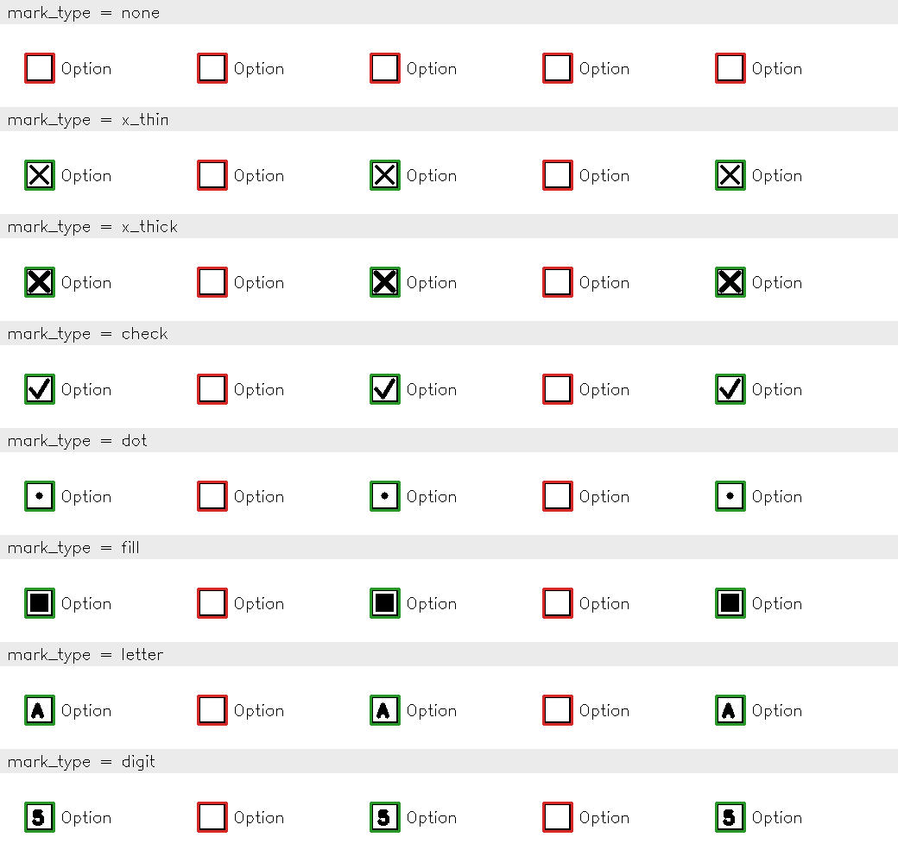
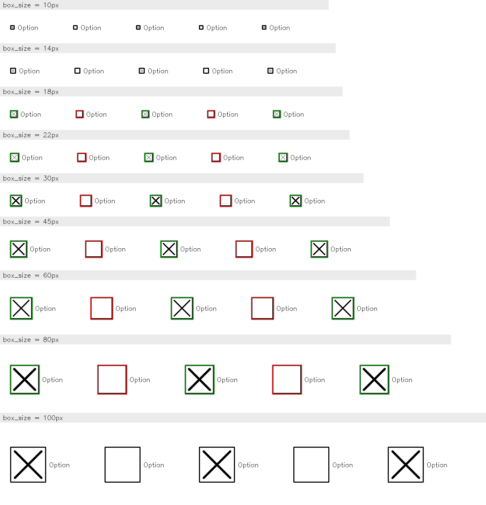
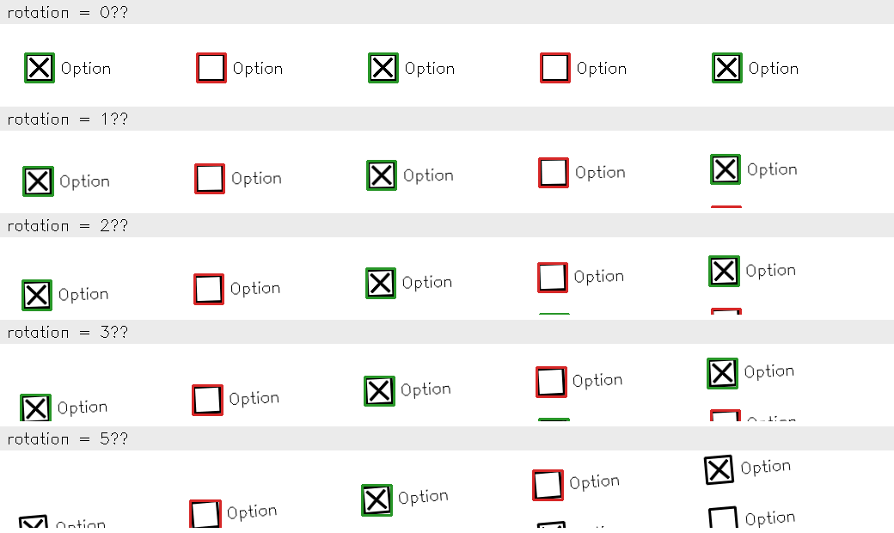

# Checkbox Detector

HTTP service that finds the checkboxes in a document image and says whether each one is checked.

It is meant to turn the checkbox fields of scanned forms, such as real-estate appraisal reports, into structured data that a downstream system can store and use, instead of someone reading each page.

```
POST /detect  (multipart, field "file")  ->  {"boxes": [{"bbox": [x1, y1, x2, y2], "is_checked": true}, ...]}
```

`bbox` is in pixels, origin at the image's top-left corner.

## Run

```bash
# Docker
docker build -t checkbox-detector .
docker run --rm -p 8000:8000 checkbox-detector

# or locally (Python 3.12+)
python3 -m venv .venv && source .venv/bin/activate
pip install -r requirements-dev.txt
uvicorn app.main:app --port 8000
```

```bash
curl -F "file=@data/samples/img-002.png" http://localhost:8000/detect
```

Open http://localhost:8000 for a demo page: upload an image or try one of the samples and see the detected boxes drawn on it.

Tests (self-contained, synthetic images):

```bash
pytest
```

`data/samples/` holds the four sample images from the challenge PDF, extracted as-is and in the same order. They are only used for evaluation, together with their hand-labeled ground truth in `eval/ground_truth/`:

```bash
python -m eval.evaluate     # metrics against the hand-labeled ground truth
python -m eval.robustness   # metrics on degraded copies (scale, blur, noise, rotation)
python -m eval.synthetic    # limits on generated forms (size, mark type, ...) -> eval/output/synthetic/
python -m eval.run          # annotated images of the predictions -> eval/output/
```

## Approach

Classical computer vision with OpenCV, no model:

1. **Grayscale that ignores color**, so red watermarks, blue signatures and shaded cells don't count as ink.
2. **Ink mask** with an adaptive threshold.
3. **Line mask**: keep only horizontal and vertical straight lines. Box borders and table grids stay; X marks, checkmarks and text go.
4. **Candidates** from two sources: regions enclosed by lines (boxes that are cells of a table) and square ink blobs with four closed sides (isolated boxes with a thick X). Filtered by size and shape.
5. **Checked** if more than 6 % of the box interior is ink.

Parameters are in `app/detection/config.py`.

**Why this approach.** There is no labeled data to train or validate a model on, and checkboxes on printed forms are a geometric shape that can be found directly. It is explainable step by step, deterministic, and fast (under 1 s per page, CPU only). A pre-trained detector or a vision LLM would be a black box with no data to validate it here; a detector trained on real labeled documents is the natural next step.

**Why Python and FastAPI.** I know HomeVision's stack is Go, TypeScript and AWS. I chose Python because it is where the computer-vision tools are (OpenCV, NumPy), Python in a data/ML context is part of the role, and it is the stack I used for image processing at SyncData IA, so it is the one I'm most comfortable with. FastAPI adds a typed response that always matches the required schema and interactive docs at `/docs`. It would still fit the platform: the detector can run as a stateless container on AWS, with the Go backend sending it documents from S3 through SQS. I worked with Claude and Cursor to make decisions, write code and design the API.

## Evaluation

The detector's output is compared against a **ground truth**: the list of boxes that really exist in an image, with their position and whether they are checked.

**Metrics.** A detected box matches a ground-truth box when they overlap with IoU ≥ 0.5 (intersection over union, the usual criterion for object detection). From the matches:

- **Precision**: share of the detected boxes that are real boxes.
- **Recall**: share of the real boxes that were found.
- **F1**: a single number combining precision and recall.
- **Classification accuracy**: share of the found boxes with the right `is_checked`.

Detection and classification are scored separately, so a drop points to the step that needs work.

There are two kinds of ground truth, which answer different questions.

### 1. The challenge samples: does it work on real documents?

`eval/ground_truth/` labels every box in the four sample images (288 boxes, 2 marked as ambiguous and left out). It was built by reviewing the detector's output section by section against the original image; that review found a bug that produced 7 false positives, since fixed.

Result: **286/286 boxes found and correctly classified, no false positives.** This is in-sample: the parameters were tuned on these same images, so it shows the samples are handled, not that it generalizes.

To get closer to unseen documents, `eval/robustness.py` scores degraded copies of the samples. Compression and small rotations barely matter (F1 ≥ 97 %). The weak points are **lower resolution** (recall drops to 89 % at 75 % scale and 58 % at 50 %, because sizes are in absolute pixels) and **blur** (88 % recall). Heavy noise lowers classification accuracy to 95 %.

### 2. Synthetic forms: where are the limits?

`eval/synthetic.py` generates forms whose answer is known by construction, so the ground truth does not depend on the detector at all. Each experiment changes one variable and keeps the rest fixed; every page is a grid of boxes where every other box gets a mark. In the sheets below each row is one value of the variable: **green** = found and read as checked, **red** = found and read as empty, **no frame** = missed.

**Mark type.** X, checkmark, dot and fill read as checked, but so do a letter or a digit: anything inside the box counts as a mark.



**Box size.** Boxes from 18 to 80 px are always found; smaller or larger ones never, because the size range is fixed in `config.py`.



**Rotation.** Up to 3° works; at 5° half of the boxes are lost, because the line mask expects horizontal and vertical lines.



Of the other experiments, only mark size shows a limit: an X covering 20 % of the box reads as empty, from 30 % up it reads as checked. Border width, gray ink, boxes inside a table and noise show no failures (on synthetic pages the background is pure white, which is why noise hurts more on the real samples). Run `python -m eval.synthetic` to print every table and write all the sheets to `eval/output/synthetic/`.

## Abuse and garbage input

The service will process any image it can decode: a single square drawn on a blank page comes back as a checkbox, and a page full of squares comes back as hundreds of them. That is the correct answer for what it sees, so the question is cost and validity, handled at three levels:

- **In the service:** files over 20 MB and images over 40 megapixels are rejected (`413`), and the detector's cost grows linearly with the number of boxes. A page with 4,900 boxes takes under 1 s; an earlier version compared every box with every other and took 15 s, which made such images a cheap way to tie up the server. A test guards this.
- **In front of the service (not built here):** API keys, per-client rate limiting, request timeouts and the upload size limit at the proxy belong in the API gateway, not in the detector.
- **Before the service:** deciding whether an image is a document worth analysing (an appraisal form vs. anything else) is a document-classification step upstream. The detector stays generic and does not encode which documents a client cares about.

## Limitations and next steps

- **Sizes are in absolute pixels.** Next: estimate the page scale and derive the size limits from it.
- **No deskew**: works up to a few degrees of rotation.
- **Any small closed square is a checkbox**, and anything inside it is a mark: a table cell with a number would be reported as a checked box. Next: a small classifier on each crop (mark / text / empty).
- **Marks that run outside the box** (a thick X past the corners, a strike-through line, a scribble) make the box disappear from the output, not just read as empty: the stroke splits the box interior in the line mask, and the ink blob is no longer square. Thin strokes that run outside are fine. This is common on hand-filled forms, and the right fix is a trained detector (e.g. a small YOLO model on labeled real forms) rather than more geometric rules, which would keep chasing new mark shapes.
- **Colored ink is ignored on purpose**, so a checkmark in blue pen is missed.
- **Faint boxes** are not detected, and **stray strokes** inside an empty box count as a mark.
- Production hardening (marked as `TODO` in the code): read the image dimensions before decoding, so a small file that decodes to a huge image is rejected before using the memory; add logging and metrics.
